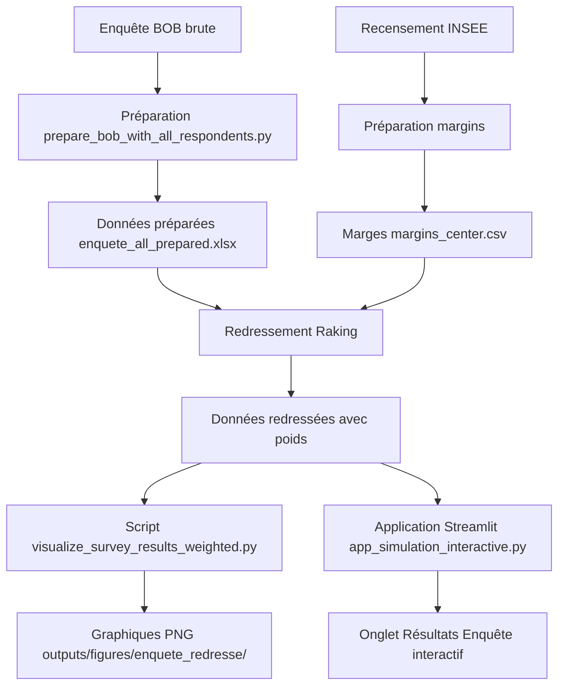

# 📋 Visualisation des Résultats de l'Enquête Redressés

## 📊 Vue d'Ensemble

Le projet BOB inclut maintenant une **visualisation complète des résultats de l'enquête redressés** selon les effectifs réels de la population des IRIS centre-ville de Besançon.

---

## 🎯 Objectif

### **Pourquoi redresser les résultats ?**

L'échantillon de l'enquête ne reflète pas exactement la structure démographique de la population cible :

| Problème | Solution |
|----------|----------|
| ❌ **Sur-représentation** de certains profils (ex: femmes, jeunes) | ✅ **Redressement par raking** pour corriger les biais |
| ❌ **Sous-représentation** d'autres profils (ex: hommes, seniors) | ✅ **Application de poids** pour chaque répondant |
| ❌ **Résultats biaisés** non représentatifs | ✅ **Résultats représentatifs** de la population IRIS |

---

## 🔧 Deux Outils Disponibles

### **1. Script Standalone - Génération de Graphiques PNG**

**Fichier** : `scripts/visualize_survey_results_weighted.py`

**Fonction** : Génère des graphiques haute résolution (PNG 300dpi) sauvegardés dans `outputs/figures/enquete_redresse/`

#### **Utilisation**

```bash
cd D:\python_work\bob-enquete
python scripts/visualize_survey_results_weighted.py
```

#### **Sorties Générées**

| Fichier | Description |
|---------|-------------|
| `dashboard_enquete_redresse.png` | Tableau de bord récapitulatif (9 graphiques) |
| `01_interet_projet.png` | Intérêt pour le projet (brut vs redressé) |
| `02_accepte_cotisation.png` | Acceptation cotisation (brut vs redressé) |
| `03_deja_utilise.png` | Utilisation de services de location/prêt |
| `04_partage_objets.png` | Partage d'objets personnels |
| `05_prix_max_location.png` | Distribution du prix maximum accepté |
| `06_interet_par_age.png` | Intérêt selon l'âge |
| `07_interet_par_csp.png` | Intérêt selon la CSP |
| `08_cotisation_par_age.png` | Acceptation cotisation selon l'âge |
| `09_partage_par_sexe.png` | Partage d'objets selon le sexe |

---

### **2. Application Interactive Streamlit - Onglet "Résultats Enquête"**

**Fichier** : `scripts/app_simulation_interactive.py`

**Fonction** : Visualisation interactive des résultats redressés avec possibilité de changer les analyses en temps réel.

#### **Utilisation**

```bash
cd D:\python_work\bob-enquete
python -m streamlit run scripts/app_simulation_interactive.py
```

Ou : **Double-clic sur `lancer_app.bat`**

#### **Navigation**

1. Ouvrir l'application
2. Cliquer sur l'onglet **"📋 Résultats Enquête"**
3. Explorer les 4 sous-onglets :
   - 🎯 **Intérêt & Cotisation**
   - 🔄 **Partage & Usage**
   - 💶 **Prix & Budget**
   - 📊 **Analyses Croisées**

---

## 📈 Contenu de l'Onglet "Résultats Enquête"

### **Métriques Principales**

Affichées en haut de l'onglet :

| Métrique | Description |
|----------|-------------|
| **Répondants Besançon** | Nombre de répondants de Besançon (après filtrage) |
| **Poids min** | Poids minimal appliqué (proche de 0 si sur-représenté) |
| **Poids max** | Poids maximal appliqué (élevé si sous-représenté) |
| **Poids moyen** | Poids moyen (~500 pour 50 répondants et 25k population) |

---

### **Sous-onglet 1 : 🎯 Intérêt & Cotisation**

#### **Graphiques**

1. **Intérêt pour le projet** (Pie chart)
   - Résultats redressés
   - Comparaison avec résultats bruts

2. **Acceptation cotisation** (Pie chart)
   - Résultats redressés
   - Comparaison avec résultats bruts

#### **Tableaux Comparatifs**

Pour chaque question :
- Colonne "Brut (%)" : Résultats de l'échantillon
- Colonne "Redressé (%)" : Résultats représentatifs de la population

**Exemple** :

| Réponse | Brut (%) | Redressé (%) |
|---------|----------|--------------|
| Oui | 65.0 | 58.2 |
| Non | 35.0 | 41.8 |

---

### **Sous-onglet 2 : 🔄 Partage & Usage**

#### **Graphiques**

1. **Accepte de partager des objets** (Bar chart)
   - Distribution Oui/Non redressée

2. **A déjà utilisé des services de location/prêt** (Bar chart)
   - Distribution Oui/Non redressée

#### **Interprétation**

- Vert foncé = Plus de réponses "Oui"
- Bleu foncé = Plus de réponses "Oui"

---

### **Sous-onglet 3 : 💶 Prix & Budget**

#### **Métriques**

| Métrique | Description |
|----------|-------------|
| **Prix moyen (Redressé)** | Moyenne pondérée du prix maximum accepté |
| **Prix moyen (Brut)** | Moyenne simple de l'échantillon |
| **Différence** | Écart entre redressé et brut |

#### **Histogramme**

- **Distribution du prix maximum accepté** (redressé)
- Ligne rouge : Moyenne pondérée
- Bins : 15 intervalles

**Exemple d'interprétation** :
- Prix moyen redressé : 4.23€
- Prix moyen brut : 4.50€
- **Différence : -0.27€** → La population est légèrement moins disposée à payer que l'échantillon

---

### **Sous-onglet 4 : 📊 Analyses Croisées**

#### **Sélecteurs Interactifs**

1. **Variable à analyser** (dropdown)
   - Intérêt pour le projet
   - Acceptation cotisation
   - Partage d'objets

2. **Variable de profil** (dropdown)
   - Tranche d'âge
   - Sexe
   - Situation professionnelle (CSP)

#### **Graphique Dynamique**

- **Bar chart groupé** : Comparaison des réponses selon le profil
- **Tableau détaillé** : Pourcentages pour chaque croisement

**Exemple : Intérêt selon l'âge**

| Âge | Oui (%) | Non (%) |
|-----|---------|---------|
| 18-24 | 72.3 | 27.7 |
| 25-34 | 65.1 | 34.9 |
| 35-44 | 58.9 | 41.1 |
| 45-54 | 54.2 | 45.8 |
| 55-64 | 48.7 | 51.3 |
| 65+ | 42.1 | 57.9 |

**Interprétation** : L'intérêt diminue avec l'âge (redressé).

---

## 🔍 Méthode de Redressement

### **Algorithme : Raking (IPF - Iterative Proportional Fitting)**

#### **Principe**

1. **Marges cibles** : Effectifs réels de la population par âge, sexe, CSP (issues du recensement INSEE)
2. **Itérations** : Ajustement itératif des poids pour faire correspondre l'échantillon aux marges
3. **Convergence** : Arrêt quand les écarts sont < 1% (tolérance)

#### **Paramètres (config.yaml)**

```yaml
raking:
  max_iterations: 500
  tolerance: 0.01
  initial_weight: 1.0
  min_weight: 0.01
  max_weight: 1000.0
```

#### **Formule du Poids**

Pour chaque répondant \(i\) :

\[
w_i = w_{initial} \times \prod_{k} \frac{N_k^{target}}{N_k^{sample}}
\]

Où :
- \(w_i\) : Poids final du répondant \(i\)
- \(N_k^{target}\) : Effectif cible pour la catégorie \(k\)
- \(N_k^{sample}\) : Effectif échantillon pour la catégorie \(k\)

---

## 📊 Interprétation des Résultats

### **Poids Élevés (> 100)**

**Signification** : Profil sous-représenté dans l'échantillon

**Exemple** :
- Homme, 55-64 ans, Actif → Poids = 450
- Signifie que ce répondant "représente" 450 personnes dans la population

### **Poids Faibles (< 1)**

**Signification** : Profil sur-représenté dans l'échantillon

**Exemple** :
- Femme, 25-34 ans, Étudiante → Poids = 0.3
- Signifie que ce répondant ne "représente" que 30% d'une personne (contribution réduite)

### **Poids Moyens (~1)**

**Signification** : Profil bien représenté

**Exemple** :
- Homme, 35-44 ans, Actif → Poids = 1.2
- Profil équilibré, contribution légèrement supérieure

---

## 🎯 Cas d'Usage

### **1. Présentation des Résultats**

**Objectif** : Montrer les résultats représentatifs de la population

**Méthode** :
1. Lancer l'application Streamlit
2. Aller dans l'onglet "📋 Résultats Enquête"
3. Sous-onglet "🎯 Intérêt & Cotisation"
4. Projeter les graphiques redressés

**Avantage** : Résultats crédibles et défendables

---

### **2. Rapport Final PDF**

**Objectif** : Intégrer les graphiques dans un rapport

**Méthode** :
1. Exécuter `python scripts/visualize_survey_results_weighted.py`
2. Récupérer les PNG dans `outputs/figures/enquete_redresse/`
3. Insérer dans Word/PowerPoint/LaTeX

**Avantage** : Graphiques haute qualité (300dpi)

---

### **3. Analyse Approfondie**

**Objectif** : Comprendre les comportements par profil

**Méthode** :
1. Application Streamlit → "📋 Résultats Enquête"
2. Sous-onglet "📊 Analyses Croisées"
3. Tester différentes combinaisons :
   - Intérêt × Âge
   - Cotisation × CSP
   - Partage × Sexe

**Avantage** : Identification des segments porteurs

---

### **4. Comparaison Brut vs Redressé**

**Objectif** : Justifier le redressement

**Méthode** :
1. Consulter les tableaux "Comparaison Brut vs Redressé"
2. Montrer les écarts de pourcentage
3. Expliquer les raisons (sur/sous-représentation)

**Avantage** : Transparence méthodologique

---

## 📚 Exemple d'Interprétation Complète

### **Question : "Une bibliothèque d'objets à Besançon vous intéresserait-elle ?"**

#### **Résultats Bruts (Échantillon)**

| Réponse | n | % |
|---------|---|---|
| Oui | 33 | 66.0% |
| Non | 17 | 34.0% |

**Interprétation brute** : 2/3 des répondants sont intéressés.

#### **Résultats Redressés (Population)**

| Réponse | n pondéré | % |
|---------|-----------|---|
| Oui | 14,872 | 58.6% |
| Non | 10,509 | 41.4% |

**Interprétation redressée** : Un peu moins de 60% de la population est intéressée (différence de -7.4 points).

#### **Explication de l'Écart**

**Hypothèse** : L'échantillon contient plus de jeunes (qui sont plus intéressés) que la population réelle.

**Vérification** :
- Échantillon : 40% de 18-34 ans
- Population : 25% de 18-34 ans
- **Sur-représentation de +15 points**

**Conclusion** : Le redressement corrige ce biais en réduisant le poids des jeunes et en augmentant celui des seniors (moins intéressés).

---

## ⚙️ Configuration

### **Fichiers Requis**

| Fichier | Emplacement | Description |
|---------|-------------|-------------|
| **Enquête BOB** | `data/raw/enquete_all_prepared.xlsx` | Données préparées avec `is_besancon` |
| **Marges INSEE** | `data/margins/margins_center.csv` | Effectifs IRIS par âge/sexe/CSP |
| **Configuration** | `config.yaml` | Paramètres du redressement |

### **Variables Utilisées**

| Variable | Type | Valeurs |
|----------|------|---------|
| `interet_projet` | Catégorielle | Oui / Non |
| `accepte_cotisation` | Catégorielle | Oui / Non / Autres |
| `partage_oui` | Catégorielle | Oui / Non |
| `deja_utilise_services` | Catégorielle | Oui / Non |
| `prix_max_location` | Numérique | 0.5 - 10.0 € |
| `age_group` | Catégorielle | 18-24, 25-34, ... |
| `sexe` | Catégorielle | F / M |
| `csp` | Catégorielle | Actifs / Étudiants / Retraités |

---

## 🔄 Workflow Complet



---

## ✅ Checklist de Vérification

Avant de présenter les résultats :

- [ ] Les données sont bien préparées (`enquete_all_prepared.xlsx` existe)
- [ ] Les marges INSEE sont correctes (`margins_center.csv` vérifié)
- [ ] Le redressement a convergé (vérifier les logs)
- [ ] Les poids sont raisonnables (min > 0.01, max < 1000)
- [ ] Les graphiques sont générés sans erreur
- [ ] L'application Streamlit se lance correctement
- [ ] Les résultats redressés sont cohérents (comparaison brut vs redressé)

---

## 🆘 Dépannage

### **Problème : "Erreur lors du chargement des données de l'enquête"**

**Cause** : Fichier manquant ou mal configuré

**Solution** :
1. Vérifier que `data/raw/enquete_all_prepared.xlsx` existe
2. Vérifier `config.yaml` → `paths.raw_data`
3. Exécuter `python scripts/prepare_bob_with_all_respondents.py`

### **Problème : "Le redressement ne converge pas"**

**Cause** : Échantillon trop déséquilibré

**Solution** :
1. Augmenter `max_iterations` dans `config.yaml`
2. Assouplir `tolerance` (ex: 0.05)
3. Augmenter `max_weight` (ex: 2000)

### **Problème : "Poids tous identiques (1.0)"**

**Cause** : Redressement non appliqué

**Solution** :
1. Vérifier que `df_besancon` n'est pas vide
2. Vérifier les marges INSEE (`margins_center.csv`)
3. Vérifier les variables de redressement dans `config.yaml`

### **Problème : "Graphiques vides dans l'application"**

**Cause** : Colonnes manquantes dans les données

**Solution** :
1. Vérifier les noms de colonnes (`interet_projet`, `accepte_cotisation`, etc.)
2. Exécuter `python scripts/list_columns.py` pour voir les colonnes disponibles
3. Adapter le script si nécessaire

---

## 📖 Documentation Associée

- **README_FINAL.md** : Vue d'ensemble du projet
- **STRATEGIE_ANALYSES.md** : Explication de la stratégie d'analyse
- **METHODOLOGIE_CALCUL.md** : Détails sur le redressement
- **TARIFS_COTISATION_LOCATION.md** : Système de tarification
- **NOUVEAUTES_V2.md** : Nouvelles fonctionnalités V2.0

---

## 🎊 Résumé

### **Ce qui est disponible**

✅ **Script standalone** : Génère 10 graphiques PNG haute résolution  
✅ **Onglet interactif** : Visualisation dynamique dans Streamlit  
✅ **4 sous-onglets** : Intérêt, Partage, Prix, Analyses croisées  
✅ **Comparaison brut/redressé** : Pour justifier le redressement  
✅ **Analyses par profil** : Âge, Sexe, CSP  
✅ **Tableaux détaillés** : Export et consultation facile  

### **Comment l'utiliser**

**Pour une présentation** :
```bash
python -m streamlit run scripts/app_simulation_interactive.py
```
→ Onglet "📋 Résultats Enquête"

**Pour un rapport** :
```bash
python scripts/visualize_survey_results_weighted.py
```
→ Récupérer les PNG dans `outputs/figures/enquete_redresse/`

---

**Version** : 2.1  
**Date** : 30 octobre 2025  
**Statut** : ✅ Opérationnel  

🚀 **Testez maintenant les résultats redressés !**

