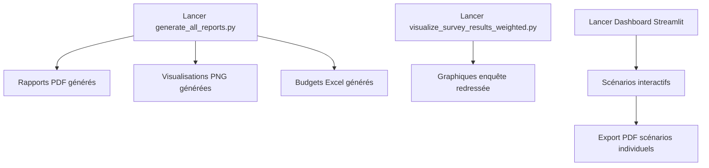

# 📊 Scripts d'Export de Rapports et Figures

## 🎯 Scripts Principaux

### **1. `scripts/generate_all_reports.py` - Script Master** ⭐

**Le script principal** qui génère TOUS les rapports et figures en une seule fois avec un timestamp unique.

#### **Utilisation**

```bash
cd D:\python_work\bob-enquete
python scripts/generate_all_reports.py
```

#### **Ce qu'il génère**

**Rapports PDF :**
- `synthese_executive_YYYYMMDD_HHMMSS.pdf` - Résumé exécutif (5 pages)
- `rapport_enrichi_YYYYMMDD_HHMMSS.pdf` - Rapport enrichi avec analyses par profil

**Visualisations PNG :**
- `dashboard_heatmap_YYYYMMDD_HHMMSS.png` - Heatmap âge × sexe
- `dashboard_barplot_YYYYMMDD_HHMMSS.png` - Graphiques par profil
- `dashboard_pyramid_YYYYMMDD_HHMMSS.png` - Pyramide des âges
- `dashboard_contribution_YYYYMMDD_HHMMSS.png` - Contribution par profil
- `dashboard_summary_YYYYMMDD_HHMMSS.png` - Tableau de bord récapitulatif

**Budgets Excel :**
- `budget_previsionnel_YYYYMMDD_HHMMSS.xlsx` - Budget prévisionnel simple
- `budget_interactif_YYYYMMDD_HHMMSS.xlsx` - Budget interactif (4 scénarios)

#### **Avantages**

✅ **Timestamp unique** : Tous les fichiers utilisent le même timestamp  
✅ **Pas de doublons** : Évite les générations multiples  
✅ **Pipeline complet** : 6 étapes automatiques  
✅ **Rapports complets** : Tous les analyses incluses  

---

### **2. `scripts/visualize_survey_results_weighted.py`**

**Génère les graphiques des résultats de l'enquête redressés.**

#### **Utilisation**

```bash
cd D:\python_work\bob-enquete
python scripts/visualize_survey_results_weighted.py
```

#### **Ce qu'il génère**

**Dans `outputs/figures/enquete_redresse/` :**

- `dashboard_enquete_redresse.png` - Tableau de bord récapitulatif (9 graphiques)
- `01_interet_projet.png` - Intérêt pour le projet (brut vs redressé)
- `02_accepte_cotisation.png` - Acceptation cotisation (brut vs redressé)
- `03_deja_utilise.png` - Utilisation de services
- `04_partage_objets.png` - Partage d'objets
- `05_prix_max_location.png` - Distribution du prix maximum
- `06_interet_par_age.png` - Intérêt selon l'âge
- `07_interet_par_csp.png` - Intérêt selon la CSP
- `08_cotisation_par_age.png` - Cotisation selon l'âge
- `09_partage_par_sexe.png` - Partage selon le sexe

#### **Avantages**

✅ **Graphiques redressés** : Résultats représentatifs de la population  
✅ **Comparaisons** : Brut vs Redressé pour chaque question  
✅ **Haute qualité** : PNG 300dpi pour impression  

---

## 📋 Comparaison des Scripts

| Script | Type | Contenu | Format |
|--------|------|---------|--------|
| **`generate_all_reports.py`** | Master | Tous les rapports + figures + budgets | PDF + PNG + Excel |
| **`visualize_survey_results_weighted.py`** | Spécialisé | Graphiques enquête redressée | PNG |
| **Dashboard Streamlit** | Interactif | Scénarios ajustables en temps réel | Web |

---

## 🚀 Utilisation Recommandée

### **Pour une Génération Complète**

**Scénario 1 : Tout générer d'un coup**

```bash
cd D:\python_work\bob-enquete
python scripts/generate_all_reports.py
```

**Résultat** :
- ✅ Tous les rapports PDF
- ✅ Toutes les visualisations
- ✅ Tous les budgets Excel
- ✅ Timestamp unique pour tout

---

### **Pour les Graphiques d'Enquête Redressés**

**Scénario 2 : Uniquement les graphiques redressés**

```bash
cd D:\python_work\bob-enquete
python scripts/visualize_survey_results_weighted.py
```

**Résultat** :
- ✅ 10 graphiques PNG haute résolution
- ✅ Résultats redressés selon les IRIS
- ✅ Comparaisons brut vs redressé

---

### **Pour les Scénarios Interactifs**

**Scénario 3 : Dashboard interactif**

```bash
cd D:\python_work\bob-enquete
python -m streamlit run scripts/app_simulation_interactive.py
```

**Résultat** :
- ✅ Interface web interactive
- ✅ Export PDF des scénarios individuels
- ✅ Ajustements en temps réel

---

## 📁 Emplacements des Fichiers Générés

### **Par `generate_all_reports.py`**

```
outputs/
├── reports/
│   ├── synthese_executive_YYYYMMDD_HHMMSS.pdf
│   ├── rapport_enrichi_YYYYMMDD_HHMMSS.pdf
│   ├── budget_previsionnel_YYYYMMDD_HHMMSS.xlsx
│   └── budget_interactif_YYYYMMDD_HHMMSS.xlsx
└── figures/
    ├── dashboard_heatmap_YYYYMMDD_HHMMSS.png
    ├── dashboard_barplot_YYYYMMDD_HHMMSS.png
    ├── dashboard_pyramid_YYYYMMDD_HHMMSS.png
    ├── dashboard_contribution_YYYYMMDD_HHMMSS.png
    └── dashboard_summary_YYYYMMDD_HHMMSS.png
```

### **Par `visualize_survey_results_weighted.py`**

```
outputs/
└── figures/
    └── enquete_redresse/
        ├── dashboard_enquete_redresse.png
        ├── 01_interet_projet.png
        ├── 02_accepte_cotisation.png
        └── ... (10 fichiers au total)
```

### **Par le Dashboard Streamlit**

```
outputs/
├── reports/
│   └── scenario_bob_YYYYMMDD_HHMMSS.pdf
└── temp_export/
    ├── repartition_revenus_YYYYMMDD_HHMMSS.png
    ├── distribution_age_YYYYMMDD_HHMMSS.png
    └── repartition_cotisations_YYYYMMDD_HHMMSS.png
```

---

## 🔄 Workflow Recommandé

### **Workflow Complet**



### **Ordre d'Exécution Recommandé**

1. **Première fois** : `python scripts/generate_all_reports.py`
   - Génère tous les rapports de base

2. **Pour les graphiques redressés** : `python scripts/visualize_survey_results_weighted.py`
   - Génère les graphiques spécifiques de l'enquête

3. **Pour les scénarios** : Dashboard Streamlit
   - Explorez les scénarios interactivement
   - Exportez les scénarios intéressants en PDF

---

## 📊 Contenu Détaillé de `generate_all_reports.py`

### **Étape 1 : Préparation des Données**

- Vérifie si `enquete_all_prepared.xlsx` existe
- Sinon, exécute `prepare_bob_with_all_respondents.py`

### **Étape 2 : Rapport de Synthèse Exécutif**

- Génère un PDF de 5 pages
- Résumé des résultats principaux
- Analyses par profil

### **Étape 3 : Rapport Enrichi**

- PDF avec analyses approfondies
- Sections par profil démographique
- Segments cibles identifiés

### **Étape 4 : Tableau de Bord**

- 5 visualisations PNG :
  1. Heatmap âge × sexe
  2. Graphiques par profil
  3. Pyramide des âges
  4. Contribution par profil
  5. Tableau de bord récapitulatif

### **Étape 5 : Budget Prévisionnel Simple**

- Excel avec scénarios de base
- Calculs par profil

### **Étape 6 : Budget Interactif**

- Excel avec 4 scénarios :
  - 500 adhérents (Année 1)
  - 1000 adhérents (Année 2)
  - 1500 adhérents (Année 3)
  - 2000 adhérents (Long terme)

---

## ⚙️ Configuration

### **Dépendances Requises**

Pour `generate_all_reports.py` :
```bash
pip install pandas numpy matplotlib seaborn reportlab openpyxl
```

Pour `visualize_survey_results_weighted.py` :
```bash
pip install pandas numpy matplotlib seaborn pyyaml
```

Pour le Dashboard Streamlit :
```bash
pip install streamlit plotly reportlab kaleido
```

---

## 💡 Cas d'Usage

### **Cas 1 : Génération Complète Initiale**

**Objectif** : Produire tous les rapports pour la première fois

**Commande** :
```bash
python scripts/generate_all_reports.py
```

**Résultat** :
- Tous les rapports PDF
- Toutes les visualisations
- Tous les budgets Excel
- Fichiers avec timestamp unique

---

### **Cas 2 : Mise à Jour des Graphiques**

**Objectif** : Régénérer uniquement les graphiques après modification des données

**Commande** :
```bash
python scripts/visualize_survey_results_weighted.py
```

**Résultat** :
- Nouveaux graphiques PNG
- Résultats mis à jour

---

### **Cas 3 : Export d'un Scénario Spécifique**

**Objectif** : Documenter un scénario particulier exploré dans le dashboard

**Méthode** :
1. Ouvrir le dashboard Streamlit
2. Configurer le scénario souhaité
3. Cliquer sur "📄 Exporter le Scénario en PDF"

**Résultat** :
- PDF avec toutes les hypothèses
- KPIs détaillés
- Graphiques inclus
- Tableau par profil

---

## 🔍 Différences Clés

| Aspect | `generate_all_reports.py` | Dashboard Streamlit |
|--------|---------------------------|---------------------|
| **Type** | Script batch | Application web |
| **Timestamp** | Unique pour tous les fichiers | Unique par scénario |
| **Interactivité** | Non | Oui |
| **Export PDF** | Pré-défini | À la demande |
| **Graphiques** | Matplotlib/Seaborn | Plotly (interactifs) |
| **Utilisation** | Une fois | En continu |

---

## 📚 Documentation Associée

- **README_FINAL.md** : Vue d'ensemble du projet
- **EXPORT_PDF_SCENARIOS.md** : Guide d'export PDF depuis le dashboard
- **RESULTATS_ENQUETE_REDRESSES.md** : Guide des graphiques redressés

---

## ✅ Checklist d'Utilisation

### **Pour Générer Tous les Rapports**

- [ ] Vérifier que les données sont préparées (`enquete_all_prepared.xlsx`)
- [ ] Vérifier que les marges existent (`margins_center.csv`)
- [ ] Installer les dépendances (`pip install reportlab matplotlib seaborn`)
- [ ] Exécuter `python scripts/generate_all_reports.py`
- [ ] Vérifier les fichiers générés dans `outputs/`

### **Pour les Graphiques Redressés**

- [ ] Vérifier que les données sont préparées
- [ ] Vérifier que les marges existent
- [ ] Installer matplotlib et seaborn
- [ ] Exécuter `python scripts/visualize_survey_results_weighted.py`
- [ ] Vérifier les graphiques dans `outputs/figures/enquete_redresse/`

---

## 🎊 Résumé

### **Script Principal : `generate_all_reports.py`**

✅ **Génère tous les rapports** en une seule exécution  
✅ **Timestamp unique** pour éviter les doublons  
✅ **Pipeline complet** en 6 étapes  
✅ **Formats multiples** : PDF, PNG, Excel  

### **Script Spécialisé : `visualize_survey_results_weighted.py`**

✅ **Graphiques redressés** de l'enquête  
✅ **Comparaisons brut vs redressé**  
✅ **Haute qualité** pour impression  

### **Dashboard Streamlit**

✅ **Scénarios interactifs**  
✅ **Export PDF** des scénarios individuels  
✅ **Ajustements en temps réel**  

---

**Le script principal pour générer tous les rapports et figures est : `scripts/generate_all_reports.py`** ⭐

